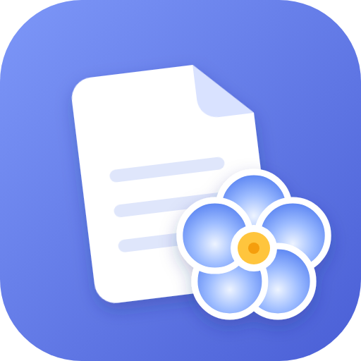
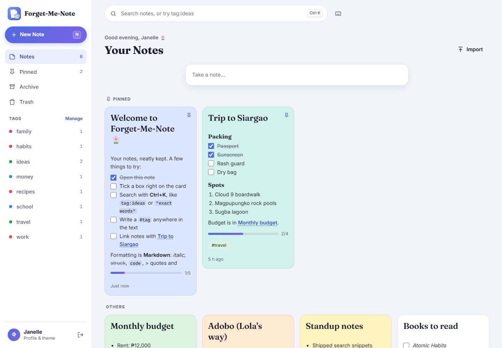
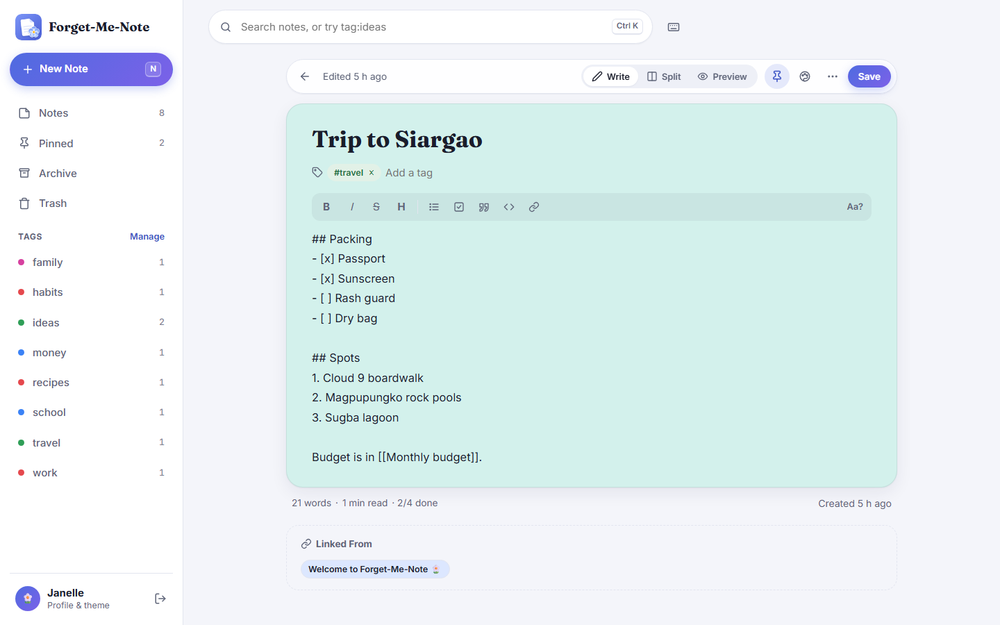
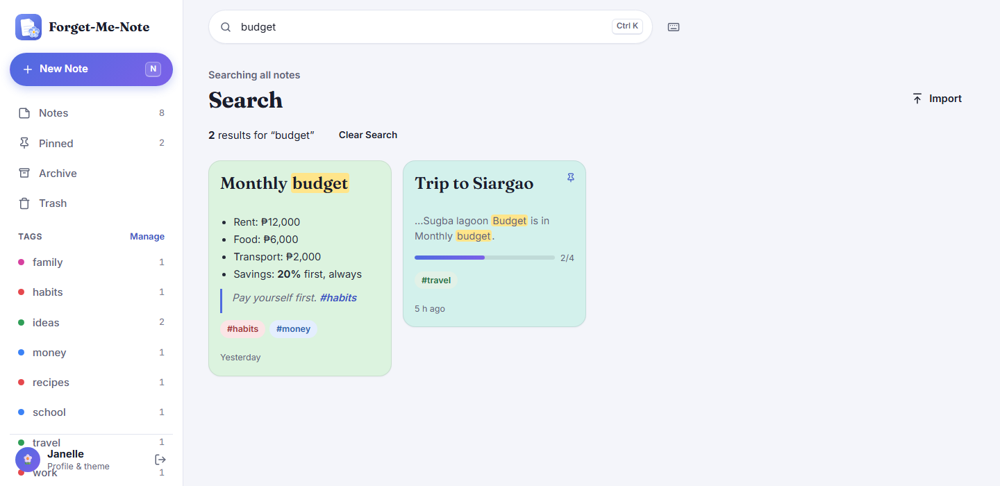
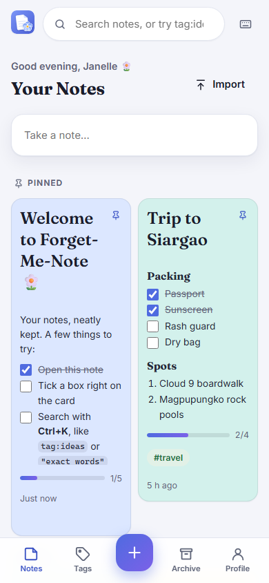
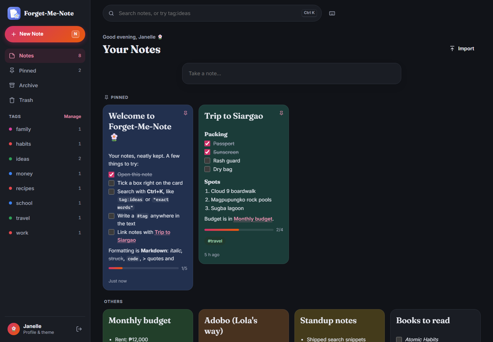
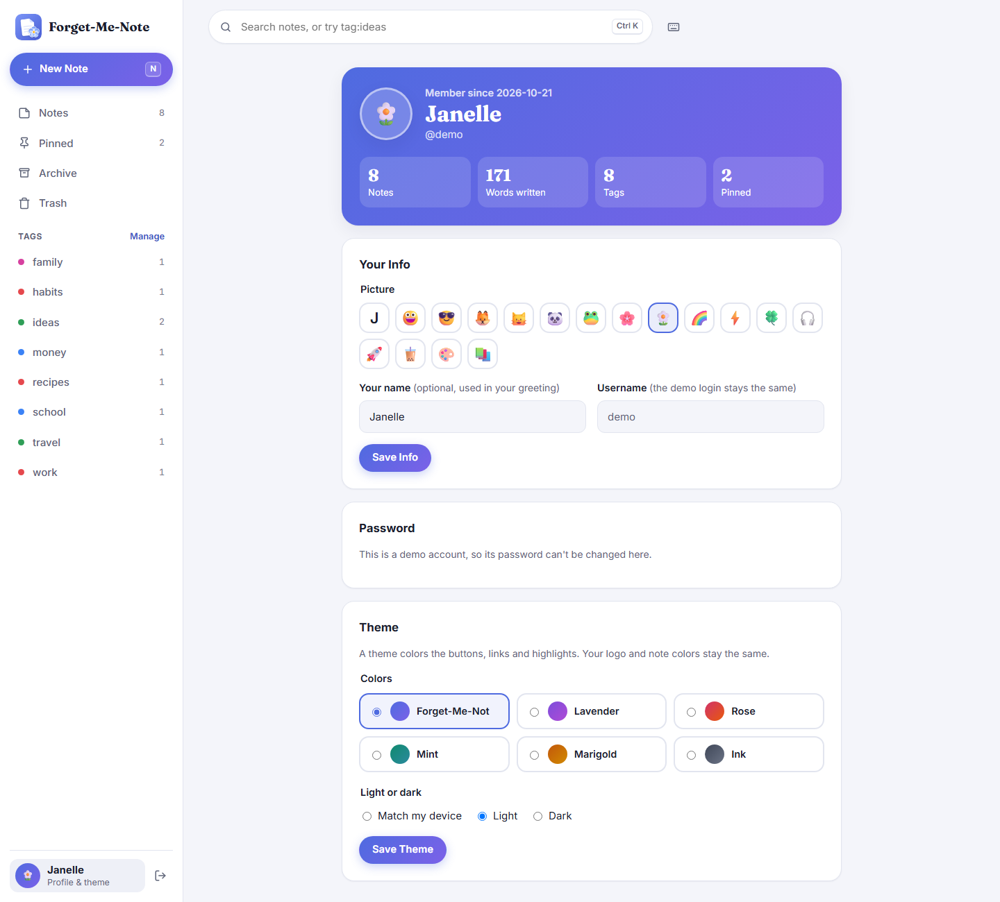
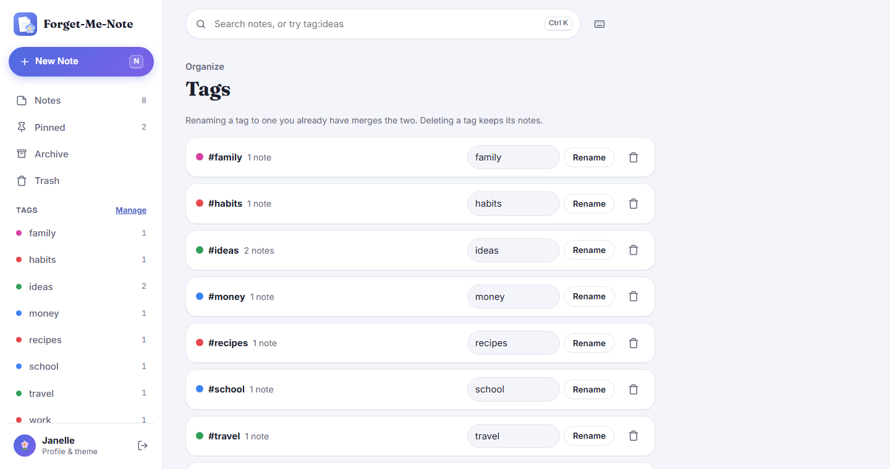

<p align="center">
  
</p>

<h1 align="center">Forget-Me-Note</h1>

<p align="center">A calm, colorful notes web app built with <b>Python</b>, <b>Flask</b> and <b>SQLite</b>, made to practice CRUD, text handling, search and data modeling. 🌼<br><i>Little notes, never forgotten.</i></p>

## Screenshots

Your notes as a grid of pastel cards. Pinned notes stay on top, checklists show their progress, and you can tick boxes right on the card.



| The editor: write, split or preview | Search with highlighted matches |
|---|---|
|  |  |

| On a phone | Dark mode (Rose theme) |
|---|---|
|  |  |

| Profile and themes | Tags |
|---|---|
|  |  |

## Features

- **Accounts**: sign up, log in and log out. Each person sees only their own notes.
- **Notes**: create, edit, copy and delete. A note needs a title *or* some text, not both.
- **Welcome tour**: four short steps the first time you log in (take a note, `#tags`, `[[links]]`, finding things). You can replay it from your profile.
- **Autosave you can trust**: the editor saves as you type. The status stays calm (a check, then "Saved 2 min ago"), only says "Saving…" when a save is slow, and if a save fails it says so, retries by itself and offers a **Retry** button.
- **Markdown, written by hand** (no library): `# headings`, `**bold**`, `*italic*`, `~~strike~~`, `` `code` ``, code blocks, bulleted and numbered lists, `- [ ]` checkboxes, `> quotes`, links and `---`. Write, Split or Preview mode. Your text is escaped first, so nothing in a note can run as code.
- **Checklists**: tick boxes on the card or in the preview, and see the progress bar fill up.
- **Tags**: type them in the tag box (chips with suggestions), or write `#tags` anywhere in the text (they show in the box as dotted "from text" chips). Click one in the sidebar to see its notes. The **Tags page** renames and deletes tags and updates the `#tags` in your text too. A rename first shows the notes it will change, and warns clearly when it will merge into a tag you already have.
- **Full-text search** with SQLite's FTS5: the best matches come first (exact words before word starts), matches are highlighted, and `bud` already finds `budget` while you type. **Filter chips** under the heading (Pinned, Has checklist, Color, Tag) switch filters on and off, and a mistyped filter like `tags:work` gets a "Did you mean `tag:work`?" (Without FTS5, a simpler search does the same job.)
- **Suggestions while typing**: type `[[` to pick a note to link, or `#` to pick a tag.
- **Links between notes**: `[[Note title]]`. A link to a note that doesn't exist yet offers to create it, and every note lists the notes that link to it (**Linked From**, with a count, folds away).
- **Drag and drop**: drag cards into your own order (it's saved), between **Pinned** and **Others** to pin or unpin, or onto the sidebar's **Pinned**, **Archive**, **Trash** or a **tag**. Works with a mouse, with a finger (press and hold, then drag), and with the keyboard (`Alt ↑` / `Alt ↓`). `Esc` cancels a drag.
- **Sort** in your own **custom order**, or by last edited, date created or title (pinned notes stay on top). Your choice is remembered. **Jump Back In** to the notes you opened last.
- **Templates**: start a checklist, meeting notes, a daily journal or an idea from **From Template**.
- **Select mode**: pin, archive, tag or trash many notes at once.
- **Focus mode** (`Ctrl Shift F`): just you and the note.
- **Copy** a note as Markdown or as plain text, and **Export All** as a zip of `.md` files.
- **Pin** notes to the top, give them one of **8 pastel colors**, and **archive** the ones you want out of the way.
- **Trash**: deleting moves a note to the Trash, with an **Undo** snackbar that stays for 10 seconds (and waits while you reach for it). Each note in the Trash shows how many days it has left. Restore it, delete it forever, or empty the Trash: only those last two ask "Are you sure?", since they can't be undone.
- **Checklists that feel good**: tick boxes on the card or in the preview, watch the bar slide along, and get a little burst of petals at 100%.
- **Note stats**: word count, reading time and checklist progress.
- **Import and export**: download a note as a `.md` file (with its title and tags at the top), or import `.md` files.
- **Profile**: pick a picture (an emoji), set the name your greeting uses, change your username or password, and choose a theme: **Forget-Me-Not** (the default), **Lavender**, **Rose**, **Mint**, **Marigold** or **Ink**, in light, dark or matching your device. The logo and app icon always stay the same.
- **Keyboard shortcuts**: `Ctrl K` or `/` search, `N` new note, `↓ ↑ Enter` move through notes, `Ctrl B`/`Ctrl I` bold/italic, `Ctrl Z` undo (formatting too), `Ctrl E` preview, `Ctrl Enter` save and close, `Esc` back, `?` the list (grouped, with a search box).
- **Accessible**: visible focus rings, labels on every icon button, sheets that keep keyboard focus inside them, 44px tap targets on touch screens, less motion for people who ask their device for it, and a test that checks text contrast on every note color.
- **Nice touches**: a greeting (you can turn it off in Profile), a quick "Take a note…" box, lists that continue when you press Enter, a bottom bar on phones that steps aside for the keyboard, and sheets you can drag down to close.

## Setup (Windows, PowerShell)

```powershell
& "$env:LOCALAPPDATA\Programs\Python\Python313\python.exe" -m venv .venv
.venv\Scripts\python -m pip install -r requirements.txt
```

## Run

```powershell
.venv\Scripts\flask --app notes run --debug
```

Then open http://127.0.0.1:5000. The database (`instance/notes.sqlite`) is created on the first run.

To make a demo account full of example notes, run `.venv\Scripts\flask --app notes create-demo` and type a username and password. Run it again to put fresh examples back. To delete every note and account, run `.venv\Scripts\flask --app notes init-db --reset`.

## Tests

```powershell
.venv\Scripts\python -m pytest
```

## Deploy (PythonAnywhere)

PythonAnywhere runs Flask apps for free and keeps the SQLite file between restarts.

1. In a **Bash console**:
   ```bash
   git clone https://github.com/jcatibog014/notes_app
   cd notes_app
   python3.13 -m venv .venv
   .venv/bin/pip install -r requirements.txt
   # Check that this SQLite has full-text search (the app falls back to a simpler search if not):
   .venv/bin/python -c "import sqlite3; sqlite3.connect(':memory:').execute('create virtual table t using fts5(a)'); print('FTS5 ok')"
   ```
2. On the **Web** tab, add a new web app with **Manual configuration** and **Python 3.13**. Then:
   - **Virtualenv**: `/home/<username>/notes_app/.venv`
   - **Static files**: URL `/static/` → directory `/home/<username>/notes_app/notes/static`
   - **WSGI configuration file**: replace its contents with:
     ```python
     import os, sys
     sys.path.insert(0, "/home/<username>/notes_app")
     os.environ["SECRET_KEY"] = "paste-a-long-random-string-here"  # never commit this
     from notes import create_app
     application = create_app()
     ```
     (Make a random key with `python3.13 -c "import secrets; print(secrets.token_hex(32))"`.)
3. Optional: `.venv/bin/flask --app notes create-demo` in the Bash console.
4. Click **Reload** and open `https://<username>.pythonanywhere.com`.

To update later: `cd notes_app && git pull`, then **Reload** on the Web tab.

## Project layout

```
notes/
  __init__.py     the app factory
  db.py           database connection and setup
  schema.sql      tables: users, notes, tags, note_tags, note_links
  schema_fts.sql  the full-text search index and its triggers
  auth.py         sign up, log in, log out
  notes.py        the home page, editor, trash, import/export
  markdown.py     the hand-written Markdown renderer and text helpers
  search.py       filters, full-text search and highlighting
  tags.py         saving tags, and the Tags page
  profile.py      the profile page
  validation.py   checks for every form
  demo.py         the create-demo command
  templates/      the pages
  static/         style.css, app.js, logo.png, logo.svg
tests/            pytest tests
```
